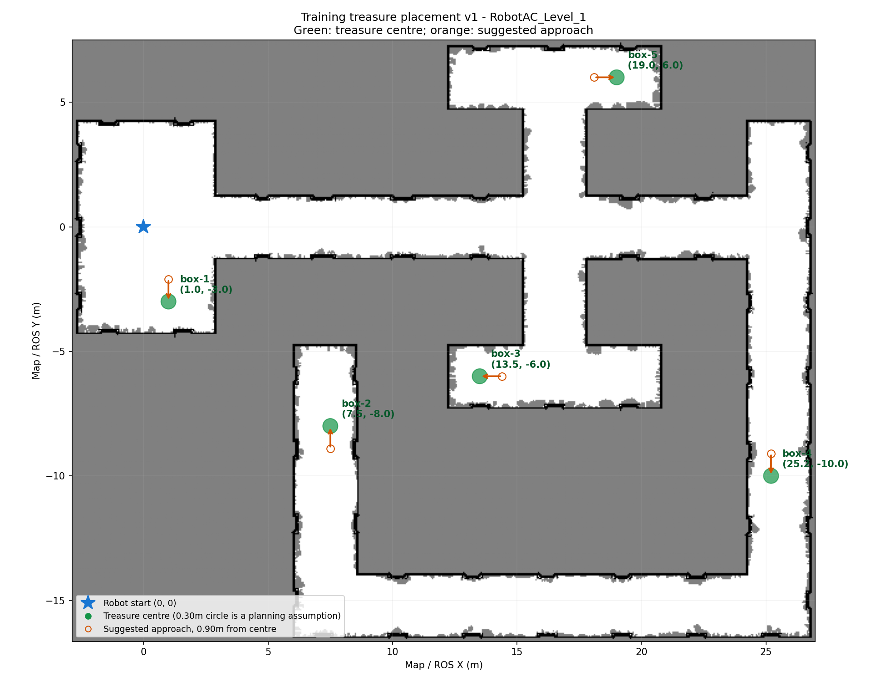

# 把场地外的五个宝箱移入场地：Ubuntu 操作

更新：2026-10-15。用户视频已确认五个真实宝箱排在地板外。本次按用户明确授权，修改官方 `RobotAC_Level_1.uexp` 中五个现有宝箱根组件的 **XY 坐标**，不新增或删除实例。保留原高度、旋转、缩放、碰撞设置、触发蓝图和计分。当前只有运行包，因此修改的是编译后的关卡资源，不需要 Unreal Editor 或重新编译仿真。

开发机已应用补丁并保留原件。**Ubuntu 必须另外应用，再完整重启 UE；单纯更新 navigation 或重启导航不会搬动箱子。** 当前已通过资源校验、备份回退测试和离线可达性检查；尚未在目标 Ubuntu 加载 UE 验证显示和接触。

## 1. 新位置与接近点

以下是当前场景的训练布局，坐标属于现有地图 `world`，单位为米。UE 坐标换算为 `(100*x, -100*y, 0)` 厘米；地图上方为正 Y。不要把 UE 的 Y 符号直接抄进 RViz。

| 编号 / 原实例 | 新中心 (x, y) | 建议接近点 (x, y) | 位置说明 |
| --- | --- | --- | --- |
| box-1 / BP_CashBox_C_1 | (1.00, -3.00) | (1.00, -2.10) | 起点房间下部，优先测试 |
| box-2 / BP_CashBox_C_2 | (7.50, -8.00) | (7.50, -8.90) | 左下方尽头支路，必须绕右侧和底部通道 |
| box-3 / BP_CashBox_C_3 | (13.50, -6.00) | (14.40, -6.00) | 中央下方横向支路左端 |
| box-4 / BP_CashBox_C_4 | (25.20, -10.00) | (25.20, -9.10) | 最右侧纵向通道，略偏左以保留通行空间 |
| box-5 / BP_CashBox_C_5 | (19.00, 6.00) | (18.10, 6.00) | 上方横向支路右端 |



每个接近点距中心 0.90 m。建议顺序 `1 → 5 → 3 → 4 → 2`，由操作者逐个选择；补丁不增加自动目标队列。box-2 从起点的实际规划约 61 m，不能隔着地图灰区直线走。先测试 box-1，其他箱子等单箱闭环通过后再试。

这组坐标只对应 `field_a_20261009_170749` 与当前 Level_1，不代表正式比赛的宝箱位置。换官方关卡后不能沿用旧坐标；工具遇到不同资源哈希会拒绝。

## 2. 先停导航和官方仿真

1. 在导航终端 Ctrl+C，确认机器狗停止，等待导航与 SDK 子进程退出。
2. 在运行 `run_sim.sh` 的终端 Ctrl+C，正常关闭 UE/MuJoCo。保持它们关闭直到第 4 节完成。
3. 不同时打开 `highlevel_demo`、遥控或另一个导航实例。无需删除运行库、重装 SDK 或运行 colcon build。

此处与只更新导航不同：**修改场景必须关闭 UE，之后必须重新启动官方仿真。** Linux 工具检测到 UE 仍在运行时会拒绝写入，不会自行杀进程。

## 3. 从 GitHub 取得工具

在 Ubuntu 新终端执行。`TASK2_PROJECT` 必须是已经跑通过的原工程，不能是新克隆的精简仓库。

```bash
export TASK2_PROJECT="$HOME/robotac/matrix_robotac_first"
export TASK2_SCENE_SOURCE="$HOME/robotac_scene_update"
test -f "$TASK2_PROJECT/run_sim.sh"
test -f "$TASK2_PROJECT/src/UeSim/Linux/UeSim/Content/Maps/RobotAC/RobotAC_Level_1.uexp"

if test -d "$TASK2_SCENE_SOURCE/.git"; then
    git -C "$TASK2_SCENE_SOURCE" pull --ff-only
else
    git clone --depth 1 https://github.com/xiaozhibuzhan/matrix_robotac_first.git "$TASK2_SCENE_SOURCE"
fi

test -f "$TASK2_SCENE_SOURCE/scene_tools/treasure_layout_v1.json"
mkdir -p "$TASK2_PROJECT/scene_tools"
cp -a "$TASK2_SCENE_SOURCE/scene_tools/." "$TASK2_PROJECT/scene_tools/"
cd "$TASK2_PROJECT"
```

以上没有复制整个 `src/`，也不会覆盖现场导航配置、地图或日志。GitHub 不保存 `scene_tools/backups/`，因此复制工具不会用别人的备份覆盖本机原件。任一 `test` 没通过时先纠正实际路径，不要在错误目录继续。

也可以从 GitHub 下载 `scene_updates/treasure_inside_v1_20261015.zip` 和同名 `.zip.sha256`，在下载目录执行：

```bash
sha256sum -c treasure_inside_v1_20261015.zip.sha256
TASK2_SCENE_STAGE="$(mktemp -d)"
unzip treasure_inside_v1_20261015.zip -d "$TASK2_SCENE_STAGE"
mkdir -p "$TASK2_PROJECT/scene_tools"
cp -a "$TASK2_SCENE_STAGE/scene_tools/." "$TASK2_PROJECT/scene_tools/"
cd "$TASK2_PROJECT"
```

## 4. 校验版本并应用

只需要系统 Python 3，不需要 source ROS 或安装新依赖：

```bash
cd "$TASK2_PROJECT"
/usr/bin/python3 -B scene_tools/treasure_layout.py status --project "$PWD"
/usr/bin/python3 -B scene_tools/treasure_layout.py apply --project "$PWD"
/usr/bin/python3 -B scene_tools/treasure_layout.py status --project "$PWD"
```

- 原包第一次 `status` 应为 `ORIGINAL`；已成功应用则为 `PATCHED`。
- `apply` 必须成功返回，最后 `status` 必须为 `PATCHED`，且列出上表五处坐标。
- 备份自动写入 `scene_tools/backups/treasure_inside_v1_20261015/`，包括原始 `.umap`、`.uexp` 与操作记录。它们不在 UE 内容目录中，不会被加载为另一个关卡。
- 重复 `apply` 不会重复平移，也不会把补丁覆盖成“原始备份”。源文件版本不符、已有备份损坏或导出组件不符时均停止，不会硬写。

支持版本的 SHA256：

| 文件状态 | SHA256 |
| --- | --- |
| `.umap`，前后保持相同 | `6806e679c7b3a811714b72464bdd9e062fa8d86a01002d75ee9ad335c5b1061a` |
| `.uexp` 原件 | `318cc497caef88b84d9813d3399d13d6767bb1c4d49fea33c85c51a0a261eee0` |
| `.uexp` 修改后 | `06a425a432cbdbd98599d50380d4dc50d2d36e39b4555c790c450c14adc1f599` |

若提示 `Unsupported`，运行以下命令保存结果，先核对是否为同一版本，不能删除校验逻辑：

```bash
sha256sum src/UeSim/Linux/UeSim/Content/Maps/RobotAC/RobotAC_Level_1.umap \
    src/UeSim/Linux/UeSim/Content/Maps/RobotAC/RobotAC_Level_1.uexp
```

## 5. 重启并验收摆放

1. 在**实际原工程**中，用此前已成功的 `run_sim.sh` 命令和参数启动官方仿真，通信与传感器仍按 [原操作手册](../navigation/OPERATIONS_UBUNTU.md#3-终端分工与环境) 启动。本次不更改启动参数；原脚本中的 MAPNAME 没有传给 UE，不能靠切换 SCENE_ID 代替本补丁。
2. 进入 UE，切换 FreeCam，用 E 升高、W/A/S/D 观察场地。检查五个箱子在地板上、没有嵌墙、没有开局自行消失。先看起点房间的 box-1，再检查其余位置。
3. 等待几秒确认五箱仍存在，保存全场截图。这一步才是 UE 实际加载与摆放验收；`PATCHED` 仅证明磁盘资源正确。
4. 按 [宝箱手册](../navigation/TREASURE_UBUNTU.md) 的 ROS 环境启动：

```bash
bash navigation/run_navigation.sh --config navigation/config/treasure_local.yaml --treasure --drive --stand-up
```

5. 起立后至少等 4 秒，等 SDK 日志 `TASK2_READY` 与导航 `DRIVE enabled`；在 RViz 用 `2D Pose Estimate` 对齐机器人实际位置和朝向。它不会搬动箱子或机器人。
6. 这次已完整重启官方仿真，因此开启新的本地回合，不 resume 旧官方回合。先 `status`，若仍有活动的旧回合，`finish` 后再 `new-round`。

```bash
/usr/bin/python3 -B -m navigation.treasure_cli status
# 只有仍有活动旧回合时执行下一行：
/usr/bin/python3 -B -m navigation.treasure_cli finish
/usr/bin/python3 -B -m navigation.treasure_cli new-round
/usr/bin/python3 -B -m navigation.treasure_cli select box-1 --radius 0.18
```

7. **0.18 m 仍是待实测的示例半径**，按实际整个箱子占据标定，允许 0.05～0.30 m。按 Publish Point 先点实际 box-1 中心附近 `(1.00,-3.00)`，再点 `(1.00,-2.10)` 接近点；两点后切回 Move Camera。坐标提示建立在地图与机器狗已经对齐的前提下，不能忽略画面偏差。
8. 等 `READY_CONTACT` 后执行 `contact`；只在 UE 中看到箱子真实消失才 `confirm --disappeared`，等停稳及 `CONFIRMED`。未消失就不确认。完整命令与异常处理见宝箱手册。

若 `PATCHED` 后箱子仍在场外，先确认已完整退出旧 UE、是在同一个原工程启动，并检查实际默认关卡；按 [场景取证](../navigation/TREASURE_TROUBLESHOOTING.md#3-补丁后仍不一致时核对实际场景) 收集证据。若开局自行消失、悬空、嵌地或 UE 加载报错，先保留画面/日志，按下节回退。当前离线验证不能替代这些运行检查。

## 6. 回退到官方原件

先停止导航、正常关闭官方仿真，再执行：

```bash
cd "$TASK2_PROJECT"
/usr/bin/python3 -B scene_tools/treasure_layout.py restore --project "$PWD"
/usr/bin/python3 -B scene_tools/treasure_layout.py status --project "$PWD"
```

应返回 `ORIGINAL`，`.uexp` 恢复为上表原始 SHA256。然后用原先的启动命令重启；箱子也会恢复到原场外位置。保留备份目录，不删除官方运行库。再次应用使用同一条 `apply` 命令即可。

## 7. 已完成的验证

- 已解析原 `.umap` 名称表和 554 项导出表，逐一核对五个 `cash_lux` 根组件、所属宝箱、原坐标、偏移与资源哈希。
- 实际只改一个 47,953 字节 `.uexp` 中五组 XY double；Z、文件长度、`.umap`、其余资源字节不变。
- 11 项集成测试通过：原件与备份校验、重复应用、精确回退、拒绝未知版本/错误导出、损坏备份保护、运行进程保护等。
- 在 0.35 m 机器人半径加 0.05 m 余量下，五处地板支撑、中心、0.90 m 接近线和从起点的路线均通过。把所有箱子假设为半径 0.30 m 的障碍后，五个接近点仍可规划；这是假设尺寸下的离线检查，不是实际碰撞形状标定。
- 796 个受检官方/任务一/地图等文件中，只有目标关卡 `.uexp` 发生变化；原始文件已备份。导航运动代码本次未改。

可在装有导航 Python 依赖的环境复查：

```bash
/usr/bin/python3 -B -m unittest discover -s scene_tools/tests -v
/usr/bin/python3 -B scene_tools/verify_layout.py --project "$PWD"
```
