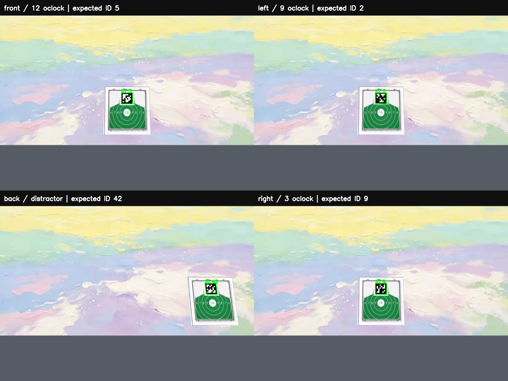

# 任务三方向与四面背景纠正（0.2.1）

本文件保留 0.2.1 历史行为与验收说明。当前 0.3.0 已将全周逆时针搜索改为三方向最短角切靶，并增加显式官方动力学入口；以 [当前说明](OFFICIAL_DYNAMICS_030.md) 为准。

## 用户回传的 Ubuntu 验收结论

已审阅 `runs_ubuntu/` 中最新完整验收记录及工程外的 `task3_acceptance` 终端文本。原 **0.2.0 一排三靶程序可以正常运行**：无窗口、双窗口两个独立进程均正常退出 0，各得 30 分、余弹 2；11 个固定场景加 100 个随机场景全部通过，325 发均为正确 ID 的 10 环，最大实际靶心偏差 8.273 mm。6 个合成单靶和 15 个图片单靶回归通过；Ubuntu 单元测试 116 项通过。

该批记录使用 Python 3.10.12、MuJoCo 3.3.7。111 个多靶运行的故障日志均为空，清理与源文件检查正常；41 个 Python 文件与原发布包哈希一致。终端的 abort/segmentation 字样出现在通过的退出码测试名称中，不是实际崩溃。完整审计见 [ubuntu_multi_020_review.json](validation/ubuntu_multi_020_review.json)。这些成绩属于旧布局，本次修改单独验收。

## 本次布局

钟点方向以机器人**初始正前方**为 12 点钟；默认初始偏航 0，世界 +X 为前、+Y 为左、+Z 为上。钟点方向与 Tag ID 是两种不同信息。

| 钟点方向 | 位置 | AprilTag ID | 靶心世界坐标（米） | 靶面朝向 |
| --- | --- | --- | --- | --- |
| 9 点钟 | 左侧 | 2 | `(0, 2.7, 0.5)` | 朝向机器人 |
| 12 点钟 | 正前方 | 5 | `(2.7, 0, 0.5)` | 朝向机器人 |
| 3 点钟 | 右侧 | 9 | `(0, -2.7, 0.5)` | 朝向机器人 |

ID 42 留在后左方作为干扰 Tag。共享 5 发弹药，射击顺序仍为 `2 → 5 → 9`，每靶最多一发；每发均记录计划 ID、实际命中 ID、环数和弹药变化。没有增加移动靶。

前、左、后、右四面墙均使用用户提供的同一张 `assets/background_source.jpg`，是实际 MuJoCo 场景渲染，未在相机输出上粘贴背景。默认房间边界为 X/Y 各 `±3.712 m`，墙顶 4.5 m，角部闭合、顶部开放；所有目标和机器人均在房间内。尺寸按板角和机器人模型包围范围加余量生成，具体值记录在每次 `generated/model_provenance.json`。墙体是纯视觉背景，不参与射线计分。

观察窗口从开放顶部查看，避免四面墙遮挡全场；机器人相机仍正常看到四面纹理。原背景与绿色靶原图保持原字节，其他 ID 继续只在派生副本中替换标记和白色留边。

四方向真实渲染与原生解码示例（后方 ID 42 仅为干扰 Tag）：



## 大角度搜索

原局部搜索无法覆盖左右相差 180° 的场地。三方向配置现在采用 `full_rotation` 模式，仅使用图像和机器人反馈，按正偏航方向扫描；目标世界坐标不传给控制器。每个新目标单独累计实际反馈转角，跨 ±π 也可正确计数；达到一周扫描预算且仍无有效检测时，发送停车指令停止继续搜索。截止目标期限前仍接受新鲜视觉重识别，并可继续视觉瞄准，但不重置扫描预算。速度滞后会产生少量滑行，不能把这个预算理解为物理转角的 360° 硬限。

每靶 45 仿真秒到期后失败并处理下一个目标；总时间上限建议 **180 仿真秒**。由于需要大角度转向，新版正常三靶运行比旧版的一排三靶用时更长。切换、重识别均重新停稳；找回目标不会重新获得一周扫描预算。丢帧或过期图像继续停车并禁止射击。缺靶验收改为靶面背向机器人，且验证其 ID 从未解码；把靶放到背后已经不能制造全周搜索下的缺靶。

## Ubuntu 更新与运行

复制 `task3_three_directions_20261019.zip` 及同名 `.zip.sha256` 到 Ubuntu。已有虚拟环境可继续使用，无需重装依赖。先在压缩包所在目录执行：

```bash
sha256sum -c task3_three_directions_20261019.zip.sha256
unzip -o task3_three_directions_20261019.zip -d "$HOME/robotac/matrix_robotac_first"
cd "$HOME/robotac/matrix_robotac_first"

# 无窗口运行仍用真实 MuJoCo 相机和原生 AprilTag。
bash task3_sim/run_task3.sh --headless \
  --config task3_sim/config/multi_fixed.json --max-seconds 180
echo $?

# 相机和场景两个窗口；完成后停住，按 Esc/Q 或关闭窗口退出。
bash task3_sim/run_task3.sh --show --viewer --realtime \
  --config task3_sim/config/multi_fixed.json --max-seconds 180
```

正常结果为 `TASK3_SUCCESS`、三发均对应正确目标、剩余 2 发，并最终出现 `TASK3_PROCESS_EXIT code=0`。需要自动关闭结果窗口可加 `--hold-seconds 5`。运行时显式给出 `--max-seconds 180`；原单靶入口的默认时间上限保持原值。

需要在 Ubuntu 重跑同一组本次布局验收：

```bash
env -u PYTHONHOME -u PYTHONPATH MUJOCO_GL=egl \
  task3_sim/.venv/bin/python -m task3_sim.validate_multi \
  --random-cases 20 --seed 20261019
```

应检查 `validation.json` 的 `complete=true`、`all_passed=true` 和全部场景；缺靶、无弹药和过期图像是预先声明的负例，不要求它们输出 SUCCESS。若仍使用旧 `local/` 副本，一排三靶的本地配置不会被更新包覆盖；先用上述默认多靶配置验证。

## 保留范围与验证边界

只改 `task3_sim/` 的自有多靶实现、配置与说明；官方模型、SDK、任务一二场景与入口均保留。原合成单靶、图片单靶配置及核心实现保持不变。旧更新 ZIP 保留，新包使用独立文件名；包内不含环境、历史 runs、local 配置或官方模型，Ubuntu 运行时从当地原模型重新生成场景。

本版开发机为 Windows、Python 3.12.3、MuJoCo 3.3.7。默认三方向场景在 38.05 仿真秒内完成三靶，三发各 10 环；125 项单元测试执行通过（122 通过，3 项 POSIX 专用测试在 Windows 跳过）；原有 6 个合成单靶和 15 个图片单靶实际渲染回归全部通过。

正式三方向验收 **31/31 通过**：11 个固定场景加 20 个种子固定的随机场景；27 场 SUCCESS，1 场缺靶 PARTIAL、2 场 NO_AMMO、1 场过期图像 TIMEOUT，均符合预先定义的预期。85 发全部命中正确目标并得 10 环，实际靶心偏差 4.38～8.96 mm，中位数 5.71 mm；随机场景用时 37.50～45.10 仿真秒。所有运行均有四面背景，故障日志为空，验收前后 41 个 Python 源文件哈希一致。

独立双窗口进程也完成三靶、余弹 2，结果展示 2 秒后正常退出 0，清理无错误。完整多场景验收进程正常退出 0。详细记录位于开发机 `runs/three_directions_validation_20261019/`、`runs/three_directions_gui_verification/`；这些原始运行目录不放入迁移包。本次只运行 20 个新布局随机样本，未把旧版的 100 个随机样本算作本次结果。

原工程 1,189 个受保护文件核对无变化：其中 1,181 个检查 SHA-256、8 个 ROS bag 仅检查大小与修改时间。14 个原单靶配置、核心模块及素材与原图片版包逐字节一致，单靶入口等 4 个函数 AST 一致。全部 41 个 Python 文件通过 Python 3.10 语法解析；这不等于本版已在 Python 3.10 实际运行。

完整本版开发机验证摘要见随包的 [three_directions_validation.json](validation/three_directions_validation.json)。Windows 验证不能代替本次修正版本在目标 Ubuntu 的运行；上面的用户回传记录只能验收 0.2.0。当前仍是带速度滞后的运动学基座与视觉闭环，未实现四足步态，也不代表实机或官方比赛计分系统。
